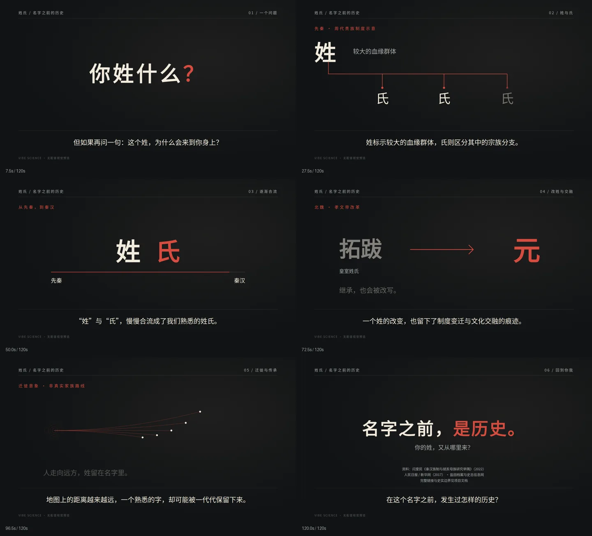

# 《姓氏｜名字之前的历史》视觉预览

阶段一：六幕动画和全部22句字幕；1920×1080，30fps，120秒。作品ID：`SurnameEvolution`。当前没有配音、音乐或最终MP4。原有HelloWorld、Logo和Title保留。

## Windows 更新与打开

请在**新开的空闲CMD**执行（不要输入到正在运行Studio的窗口）：

```bat
cd /d C:\Users\Lenovo\vibe-science
git -c http.proxy=http://127.0.0.1:7897 pull --ff-only
```

若Studio仍在运行，刷新 http://localhost:3000/SurnameEvolution 即可。若未运行，在同一空闲CMD执行：

```bat
npm run dev
```

打开 http://localhost:3000/SurnameEvolution ，选择作品后按空格播放。若终端显示其他端口，以终端地址为准。`SurnameScenes`文件夹可单独查看各幕（单幕调试视图不含全片字幕）。

拉取提示本地文件冲突时，保留修改并复制完整终端文字供排查，不执行reset --hard。GitHub保存代码、文案、时码和检查点；不能保留运行中的终端内存，重启后需要重新启动Studio。



## 六幕

| 时段 | 画面 |
|---|---|
|0–15秒|常见姓氏与“你姓什么”|
|15–40秒|周代贵族制度下姓与氏的树状示意|
|40–60秒|先秦至秦汉，姓氏逐渐合流|
|60–85秒|北魏皇室拓跋改元|
|85–108秒|无边界的迁徙光点意象|
|108–120秒|“名字之前，是历史”与资料说明|

## 验证与限制

- 时间轴校验：六幕连续、22句与批准旁白逐句一致、字幕不重叠且不跨场景。
- `npm run lint`执行ESLint与TypeScript。验证命令：`node --experimental-strip-types scripts/check-surname-timeline.ts`。
- 画面检查覆盖0、225、825、1500、2175、2895、3420、3599及所有场景交界前后1帧。代表帧使用1080p。
- 全片3,600帧已通过无音频运行渲染校验（缩小采样；非最终MP4导出）；另逐张检查1080p代表帧与边界帧。用户Windows上的Studio实时播放仍需在拉取后确认。
- 当前构建环境的网络接口枚举API不可用，验证时仅在临时渲染进程提供localhost接口信息；项目代码和用户Windows无需这一适配。
- 本环境预览安装Noto Sans CJK SC字体；Windows回退Microsoft YaHei。正式导出前需固定授权字体，避免平台字形差异。
- 完整事实来源见 `docs/surname-video-draft.md`。迁徙图不是实际路线，同姓不等于同祖。

## 依赖审计

保持全部Remotion包4.0.530，不更改package及锁文件。`npm audit --json`报告10项high、0项critical，涉及开发工具链：@remotion/eslint-config-flat、@typescript-eslint/eslint-plugin、@typescript-eslint/parser、@typescript-eslint/type-utils、@typescript-eslint/typescript-estree、@typescript-eslint/utils、typescript-eslint、fast-glob、micromatch、braces。根因报告为braces深层嵌套模式引发栈耗尽拒绝服务，其他条目为依赖传播，不是10个已确认独立攻击点。部分上游无直接修复建议，未运行audit fix --force，后续另做兼容性升级评估。

## 后续

先审阅视觉节奏，再确定中文旁白音源、校准字幕和停顿、加入音乐并导出MP4/SRT。下一次续接先读 `vibe-science-progress.md` 最新检查点，不重复初始化或回退依赖。
